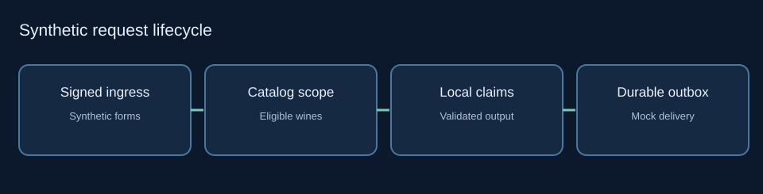

# Restaurant Wine Recommendation Reference

**Synthetic portfolio reference implementation · independently reviewable · publicly published · hosted CI verified.**

This repository demonstrates restaurant-grounded wine recommendations using a fictional catalog and an offline-tested Python service. The design filters venue inventory **before** composing customer-facing descriptions. The examples are self-contained and do not represent a deployed commercial application or an employer's source code.



## Architecture at a glance

1. Authenticate and validate an incoming form/webhook request and bind it to a trusted venue.
2. Read a venue-scoped catalog and select eligible inventory with bounded preference fallback.
3. Validate model-selected wine identifiers against the catalog; assemble **descriptions locally** from trusted facts.
4. Use a durable outbox with lease fencing, admission checks and reconciled provider outcomes.
5. Render safe HTML and submit through an injectable email transport adapter.

The example includes SQLite persistence, an optional PostgreSQL schema/migration path, Typeform-style signed requests, an OpenAI-style model adapter and Postmark-style delivery adapter. Provider endpoints are not contacted by the offline tests.

## Explore the code and evidence

- [Product contract](docs/product-contract.md), [runtime architecture](docs/runtime-architecture.md), [data model](diagrams/data-model.svg), [recommendation fallback](diagrams/recommendation-fallback.svg)
- [Catalog ingestion](docs/catalog-ingestion.md), [candidate retrieval and ranking](docs/candidate-retrieval-and-ranking.md), [webhook and email delivery](docs/webhook-and-email-delivery.md)
- [Public evidence map](docs/evidence-map.md), [verification and tradeoffs](docs/verification-and-tradeoffs.md)
- [Reference implementation guide](examples/README.md), [release acceptance policy](docs/release-acceptance.md)
- [Attribution and rights review](ATTRIBUTION.md), [copyright terms](LICENSE)

## Run locally

```bash
python examples/pipeline.py
python -B -W error::ResourceWarning -m unittest discover -s examples/tests -q
python -B scripts/release_gate.py
```

The frozen internal v18 source passed 323 unit tests and 32 archive checks before redaction. This **separate public preview** is rechecked independently, and its new SHA-256 and results must be consulted rather than assuming it is byte-identical to the frozen release. Live PostgreSQL, authenticated provider staging and production fault/load testing have **not** been certified.

**Publication status:** Public and branch-protected. Certified engineering baseline: `dc328b3f2d14acb1f8a0b59472c69d096f1832e1`, Git tree `e1b2f84fee8e1942f2a97e1d1aefbf4eeef05b6d`, 100 tracked files. [Hosted CI](https://github.com/ryanrowe2/restaurant-wine-recommendation-reference/actions/runs/43330352366) passed Python 3.10, 3.12 and 3.14: 325 tests executed, one optional skip, 86% branch coverage. Subsequent presentation edits have their own Git commit identity.

## Engineering closure and documentation history

The documentation paths below are deliberately retained for navigational continuity. Original private-source narratives, historical employer implementation details, issue discovery chronology and internal snapshots have been withheld from this publication preview. The source, tests and documented *reference* architecture remain reviewable. Refer to the separately held internal archive for historical evidence under authorized review.

- [Current v18 release closure](docs/v18-seven-finding-release-closure.md)
- [historical v13 remediation](docs/v13-five-finding-remediation.md), [historical v14 remediation](docs/v14-four-finding-remediation.md), [historical v15 remediation](docs/v15-five-finding-remediation.md)
- [historical v11 remediation](docs/v11-six-finding-remediation.md), [Historical v16 remediation](docs/v16-eight-finding-remediation.md), [v17 consolidated remediation record](docs/v17-consolidated-remediation.md)
- [Historical v9 release hardening](docs/v9-independent-four-remediation.md), [v7 security and reliability repair report](docs/v7-security-remediation.md), [v5 repair verification](docs/v5-remediation-status.md), [v4 repair verification](docs/v4-remediation-status.md), [v3 remediation status](docs/v3-remediation-status.md)

### Historical v7 release controls

The reference archive scanner checks forbidden paths, sensitive tokens and ZIP structure. Publication of this independent synthetic reference was expressly authorized by the owner and completed. The scanner remains an offline control; it does not grant IP or distribution rights.

## Publication boundary

No original employer records, nonpublic filenames, exact historical inventory figures, deployment topology or employer-derived vulnerability notes are published in this preview's documentation. This is an *independent example*, not a claim that a commercial system was fixed, operated or validated. The owner supplied publication authorization for this synthetic reference. Original-source confidentiality and third-party rights remain intact; publication does not authorize disclosure of private historical material.
