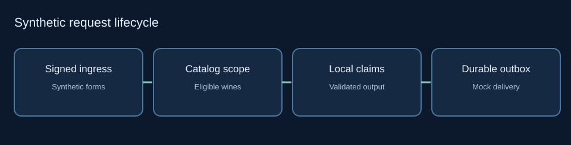

# Reference runtime architecture and trust boundaries

This page describes **only the synthetic reference implementation**. It intentionally does not document a former employer's infrastructure, machine topology, database pool sizing, operational credentials, hosting identity, or observed vulnerabilities.

| Reference boundary | Required contract |
| --- | --- |
| Ingress → request parser | Validate signed request bytes and allowed form mapping |
| Webhook → venue identity | Bind to trusted server-side venue context |
| Application → catalog | Parameterized, venue-scoped and bounded reads |
| Catalog → ranking adapter | Only eligible fictional inventory may be proposed |
| Model output → recommendation | Validate IDs and reconstruct descriptions from trusted catalog facts |
| Delivery queue → provider adapter | Durable idempotency, submission fences, receipt checks, uncertain-delivery reconciliation |

The runnable demonstration uses SQLite by default and includes separate PostgreSQL migration code. Its provider adapters can be exercised through local test doubles. **No live PostgreSQL, hosted CI, provider staging, TLS exposure, deployment or production load certification is asserted.**

See [public evidence map](evidence-map.md) and [verification notes](verification-and-tradeoffs.md).
